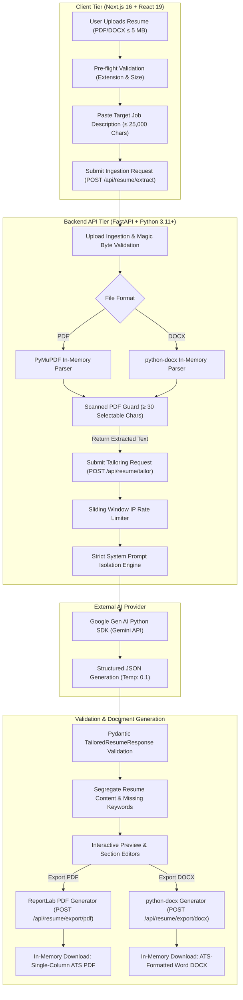

<div align="center">

# 📄 AI RESUME TAILOR

### *Tailor Smarter. Stay Truthful. Land Your Next Opportunity.*

A full-stack web application designed to tailor resumes to specific job descriptions using Google Gemini LLMs. Realigns documented candidate experience to highlight relevance without fabricating skills, hallucinating employment history, or compromising candidate integrity.

<p align="center">
  <a href="https://github.com/weber404/AI-Resume-Customiser-Web-App">
    
  </a>
  <a href="https://ai-resume-customiser-vishwasweb.vercel.app/">
    
  </a>
  <a href="https://ai-resume-customiser-web-app-production.up.railway.app/">
    
  </a>
  <a href="https://ai-resume-customiser-web-app-production.up.railway.app/docs">
    
  </a>
</p>

<p align="center">
  
  
  
  
  
  
  
  
  
</p>

<p align="center">
  <a href="https://ai-resume-customiser-vishwasweb.vercel.app/"><strong>🌐 Live Application</strong></a> •
  <a href="https://ai-resume-customiser-web-app-production.up.railway.app/docs"><strong>📖 Interactive API Docs</strong></a> •
  <a href="https://github.com/weber404/AI-Resume-Customiser-Web-App"><strong>💻 GitHub Repository</strong></a> •
  <a href="./DEPLOYMENT.md"><strong>🚀 Deployment Guide</strong></a>
</p>

</div>

---

## 📑 Table of Contents

- [Overview](#overview)
- [Key Features](#key-features)
- [Screenshots / Product Preview](#screenshots--product-preview)
- [Tech Stack](#tech-stack)
- [Architecture](#architecture)
- [Project Structure](#project-structure)
- [Getting Started](#getting-started)
- [Environment Variables](#environment-variables)
- [How It Works](#how-it-works)
- [API Reference](#api-reference)
- [Testing and Quality Assurance](#testing-and-quality-assurance)
- [Deployment](#deployment)
- [Privacy and Security](#privacy-and-security)
- [Limitations](#limitations)
- [Roadmap](#roadmap)
- [Contributing](#contributing)
- [License](#license)
- [Author](#author)

---

<a id="overview"></a>
## 🚀 Overview

**AI Resume Tailor** is a modern, privacy-conscious full-stack platform designed to help job seekers tailor resumes for specific job descriptions **without inventing false claims**.

Automated resume tools frequently hallucinate synthetic skills, fabricate unverified metrics, or insert deceptive keywords into candidate profiles. AI Resume Tailor enforces a strict, transparent contract:

> **Core Principle: Improve Relevance Without Fabricating Candidate Experience.**  
> The application realigns, restructures, and emphasizes documented past achievements that match the target job description, while segregating missing target keywords into an actionable, advisory checklist.

### Core Workflow Capabilities:
1. **Document Ingestion:** Accepts `.pdf` and `.docx` resumes (up to 5 MB), extracting normalized selectable text via PyMuPDF and python-docx.
2. **Context-Aware Tailoring:** Combines source resume text with the target job description (up to 25,000 characters) to identify semantic overlaps and gaps.
3. **Structured Resume Synthesis:** Prompts Google Gemini with strict schema enforcement to generate a single-column, ATS-aligned resume data model.
4. **Keyword Gap Segregation:** Separates unverified skills into an explicit "Missing Keywords" advisory panel with context on why the employer seeks them.
5. **In-Browser Section Editing:** Allows candidates to review, tweak, add, or delete individual bullet points, skill categories, and project summaries before exporting.
6. **In-Memory Binary Export:** Exports publication-ready resumes in both ATS-compliant PDF (ReportLab) and Word DOCX formats directly from RAM.

---

<a id="key-features"></a>
## ✨ Key Features

- **🛡️ Truthfulness-First AI Prompting:** System instructions strictly forbid the LLM from inventing employers, modifying dates, or adding technologies absent from the source document.
- **📄 Dual-Format Ingestion & Validation:** Validates file signatures (magic bytes) to prevent corrupted files, empty payloads, or renamed extensions from entering the pipeline.
- **🔍 Scanned Document Guard:** Distinguishes text-selectable PDFs from scanned, image-only documents and provides clear, immediate user guidance.
- **🏷️ Segregated Missing Keyword Analysis:** Unmatched requirements are extracted separately with actionable notes, preventing unverified claims from infiltrating the resume body.
- **✏️ Interactive Section-Wise Editing:** Modal editors allow real-time changes to Contact, Summary, Experience, Skills, Projects, Education, and Certifications.
- **🎯 Content Alignment Score:** Displays an approximate textual match percentage indicating keyword alignment (explicitly disclaiming hiring probability).
- **🖨️ Dual ATS Export Engine:**
  - **PDF Export:** Single-column layout rendered via ReportLab with orphan-heading suppression (`keepWithNext=True`) and selectable typography.
  - **DOCX Export:** Formatted OpenXML document styled with native bullet lists and standardized 0.5-inch margins.
- **🔒 Ephemeral Processing:** Documents and job descriptions are processed in memory and are not persisted to application databases or local disk storage.
- **⚡ Defense-in-Depth Security:** Enforces strict HTTP security headers (`nosniff`, `DENY`, `strict-origin`), sliding-window rate limiting, and input size constraints.

---

<a id="screenshots--product-preview"></a>
## 📸 Screenshots / Product Preview

The application features an Apple-inspired light aesthetic designed for clarity, readability, and responsive interaction:

```text
┌────────────────────────────────────────────────────────────────────────┐
│  AI Resume Tailor                                  [ Service Ready ● ] │
├────────────────────────────────────────────────────────────────────────┤
│                                                                        │
│   [ 1. Upload Resume ]                    [ 2. Target Job Description ]│
│   ┌───────────────────────────┐           ┌──────────────────────────┐ │
│   │ 📄 Click to choose file   │           │ Paste requirements,      │ │
│   │    or drag & drop         │           │ responsibilities, stack  │ │
│   │    (PDF, DOCX up to 5 MB) │           │ 0 / 25,000 characters    │ │
│   └───────────────────────────┘           └──────────────────────────┘ │
│                                                                        │
│                       [ 🪄 Tailor My Resume ]                          │
│                                                                        │
├────────────────────────────────────────────────────────────────────────┤
│   [ Tailored Resume Preview ]             [ Missing Keywords Panel ]   │
│   • Alex Morgan (Staff Backend Eng)       • Kubernetes (Orchestration) │
│   • 94% Alignment Score                   • AWS Lambda (Serverless)    │
│   • [✏️ Edit Sections]                     (Review before adding)       │
│                                                                        │
│   [ 📥 Download PDF ]                     [ 📥 Download Word (.docx) ] │
└────────────────────────────────────────────────────────────────────────┘
```

> **Live Preview:** Experience the complete interactive workflow directly on the live production deployment:  
> 👉 [https://ai-resume-customiser-vishwasweb.vercel.app/tailor](https://ai-resume-customiser-vishwasweb.vercel.app/tailor)  
> *(To add graphical screenshots, place image files in a `docs/screenshots/` folder and link them here).*

---

<a id="tech-stack"></a>
## 🧰 Tech Stack

| Layer | Technology | Purpose |
| :--- | :--- | :--- |
| **Frontend Framework** | [Next.js](https://nextjs.org/) 16.4.0 (App Router) | React server/client architecture, Turbopack, standalone compilation |
| **UI Library** | [React](https://react.dev/) 19.3.0 | Modern component hierarchy, stateful hooks, modal section editing |
| **Type Safety** | [TypeScript](https://www.typescriptlang.org/) ^5.0 | Strict compilation, shared interfaces, type-safe API communication |
| **Styling** | [Tailwind CSS](https://tailwindcss.com/) ^4.0 | Apple-inspired minimal light theme, custom responsive grid, fluid spacing |
| **Backend Framework** | [FastAPI](https://fastapi.tiangolo.com/) >=0.110.0 | High-performance asynchronous REST API, OpenAPI docs, dependency injection |
| **Data Validation** | [Pydantic v2](https://docs.pydantic.dev/) >=2.7.0 & pydantic-settings >=2.2.0 | Strict request/response schema validation and environment management |
| **ASGI Server** | [Uvicorn](https://www.uvicorn.org/) >=0.29.0 | Production ASGI server with async worker process management |
| **AI Integration** | [Google Gen AI SDK](https://github.com/google-gemini/google-genai) >=0.1.1 | Official Python client communicating with Google Gemini models |
| **PDF Extraction** | [PyMuPDF](https://pymupdf.readthedocs.io/) (fitz) >=1.23.0 | Document parsing and selectable text extraction |
| **DOCX Processing** | [python-docx](https://python-docx.readthedocs.io/) >=1.1.0 | OpenXML document parsing and structured DOCX export |
| **PDF Generation** | [ReportLab](https://www.reportlab.com/) >=4.0.0 | Programmatic ATS-compliant single-column PDF rendering from memory |
| **Testing** | [pytest](https://pytest.org/) >=8.0.0 & Node.js Native Runner | Backend async pytest suite and frontend TypeScript test runner |
| **Containerization** | [Docker](https://www.docker.com/) | Multi-stage, non-root, unprivileged container images |
| **Cloud Hosting** | [Vercel](https://vercel.com/) & [Railway](https://railway.app/) | Frontend global edge deployment & containerized backend execution |

### AI Model Details
- **Provider:** Google Gemini API via official `google-genai` Python SDK
- **Default Configured Model:** `gemini-3.5-flash-lite` (defined in [`backend/app/core/config.py`](./backend/app/core/config.py))
- **Configurable Override:** Set `GEMINI_MODEL` in backend environment (e.g. `gemini-2.5-flash`, `gemini-1.5-pro`)
- **Sampling Temperature:** `0.1` (restrained temperature ensures deterministic, factual output adhering strictly to source data)

---

<a id="architecture"></a>
## 🏗️ Architecture

The application implements a decoupled, event-driven client-server architecture with in-memory document processing:



---

<a id="project-structure"></a>
## 📂 Project Structure

```text
AI-Resume-Customiser-Web-App/
├── backend/                             # Python FastAPI Backend
│   ├── app/
│   │   ├── api/
│   │   │   └── routes/
│   │   │       ├── health.py            # /api/health, /api/health/live, /api/health/ready
│   │   │       └── resume.py            # /extract, /tailor, /export/pdf, /export/docx
│   │   ├── core/
│   │   │   ├── config.py                # Pydantic BaseSettings & env parsing
│   │   │   ├── exceptions.py            # Structured AppException & error codes
│   │   │   └── rate_limiter.py          # In-memory sliding window rate limiter
│   │   ├── schemas/
│   │   │   ├── common.py                # ErrorResponse, ErrorDetail, HealthResponse
│   │   │   ├── resume.py                # ResumeData, TailoredResumeResponse schemas
│   │   │   └── tailor.py                # TailorResumeRequest input contract
│   │   ├── services/
│   │   │   ├── exporter/                # ReportLab & python-docx binary generators
│   │   │   ├── llm/                     # Google Gen AI client & prompt templates
│   │   │   ├── parser/                  # PDF & DOCX text extraction services
│   │   │   └── tailoring.py             # Orchestration service for tailoring logic
│   │   └── main.py                      # FastAPI app instance, CORS & ASGI security headers
│   ├── tests/                           # Pytest test suite (64 automated tests)
│   │   ├── test_config.py               # Settings & environment variable tests
│   │   ├── test_export.py               # In-memory PDF & DOCX generation tests
│   │   ├── test_health.py               # Health & liveness probe tests
│   │   ├── test_production_security.py  # Rate limiting & security header tests
│   │   ├── test_resume_extract.py       # File validation & extraction tests
│   │   ├── test_schemas.py              # Pydantic contract & boundary tests
│   │   └── test_tailor.py               # AI client integration & prompt tests
│   ├── .dockerignore                    # Backend Docker ignore definitions
│   ├── .env.example                     # Backend environment template
│   ├── .gitignore                       # Backend Git ignore rules
│   ├── Dockerfile                       # Multi-stage production Python container
│   ├── pyproject.toml                   # Project metadata & pytest configuration
│   └── requirements.txt                 # Pinned Python package dependencies
│
├── frontend/                            # Next.js 16 App Router Frontend
│   ├── src/
│   │   ├── app/
│   │   │   ├── globals.css              # Design tokens & responsive site-container
│   │   │   ├── layout.tsx               # Root layout, metadata & custom favicon
│   │   │   ├── page.tsx                 # Landing page (hero, features, FAQ, CTA)
│   │   │   ├── icon.svg                 # Brand RT favicon
│   │   │   └── tailor/
│   │   │       └── page.tsx             # Interactive resume workspace & workflow
│   │   ├── components/
│   │   │   ├── HealthCheck.tsx          # Real-time backend connectivity check
│   │   │   └── workflow/                # Tailoring UI & modular section editors
│   │   │       ├── FileUploadZone.tsx   # Drag-and-drop file upload component
│   │   │       ├── JobDescriptionInput.tsx # JD textarea with deterministic counter
│   │   │       ├── TailoredResumeView.tsx # Resume preview with export & edit buttons
│   │   │       ├── MissingKeywordsPanel.tsx # Segregated keyword gap checklist
│   │   │       ├── ErrorAlert.tsx       # Standardized user error banner
│   │   │       └── editors/             # In-place modal section editors
│   │   ├── lib/
│   │   │   ├── api.ts                   # Type-safe Fetch API client with timeouts
│   │   │   └── validation.ts            # Client-side validation & size helpers
│   │   └── types/
│   │       ├── common.ts                # API error & health contracts
│   │       ├── resume.ts                # Tailored resume TypeScript models
│   │       └── index.ts                 # Centralized type exports
│   ├── tests/                           # Frontend Node test runner suite (26 tests)
│   │   ├── editing.test.ts              # Section editing & state update tests
│   │   └── workflow.test.ts             # Validation, API sequence & export tests
│   ├── .dockerignore                    # Frontend Docker ignore definitions
│   ├── .env.example                     # Frontend environment template
│   ├── .gitignore                       # Frontend Git ignore rules
│   ├── Dockerfile                       # Multi-stage production Node container
│   ├── eslint.config.mjs                # ESLint 9 configuration
│   ├── next.config.ts                   # Next.js 16 Turbopack configuration
│   ├── package.json                     # NPM dependencies & scripts
│   ├── package-lock.json                # Pinned dependency lockfile
│   └── tsconfig.json                    # Strict TypeScript configuration
│
├── .gitignore                           # Workspace root Git ignore
├── DEPLOYMENT.md                        # Production deployment guide
├── docker-compose.yml                   # Container orchestration config
└── README.md                            # Project documentation
```

---

<a id="getting-started"></a>
## 🚀 Getting Started

Follow these instructions to run both tiers of the application locally:

### 1. Prerequisites
- **Git:** 2.30+
- **Python:** 3.11+ (Python 3.11 to 3.14 verified)
- **Node.js:** 20.x or 22.x LTS (Node 20+ verified)
- **npm:** 10.x+
- **Google Gemini API Key:** [Get an API Key from Google AI Studio](https://aistudio.google.com/app/apikey)

### 2. Clone the Repository
```bash
git clone https://github.com/weber404/AI-Resume-Customiser-Web-App.git
cd AI-Resume-Customiser-Web-App
```

### 3. Backend Setup & Startup
Open a terminal in the project root:

```bash
# Navigate to backend directory
cd backend

# Create virtual environment
python3 -m venv .venv

# Activate virtual environment
# On macOS/Linux:
source .venv/bin/activate
# On Windows (Command Prompt / PowerShell):
# .venv\Scripts\activate

# Install dependencies
pip install -r requirements.txt

# Configure environment
cp .env.example .env
# Edit .env and paste your GEMINI_API_KEY

# Start backend server
uvicorn app.main:app --reload --host 127.0.0.1 --port 8000
```

Verify backend health at: [http://127.0.0.1:8000/api/health](http://127.0.0.1:8000/api/health)  
Interactive API Swagger Docs: [http://127.0.0.1:8000/docs](http://127.0.0.1:8000/docs)

### 4. Frontend Setup & Startup
Open a second terminal window in the project root:

```bash
# Navigate to frontend directory
cd frontend

# Install Node dependencies
npm install

# Configure environment
cp .env.example .env.local

# Start frontend development server
npm run dev
```

Open [http://localhost:3000](http://localhost:3000) in your browser to start tailoring resumes.

---

<a id="environment-variables"></a>
## 🔐 Environment Variables

The project separates client-side configuration from secure server-side settings.

### 1. Backend Environment Variables (`backend/.env`)

| Variable Name | Default Value | Required in Production | Purpose & Details |
| :--- | :--- | :--- | :--- |
| `ENVIRONMENT` | `development` | **Yes** | Set to `production` in live environments. |
| `DEBUG` | `true` | **Yes** | Set to `false` in production to suppress stack traces. |
| `PORT` | `8000` | No | Listening port for the ASGI server. |
| `FRONTEND_ORIGIN` | `http://localhost:3000` | **Yes** | Public HTTPS origin of the frontend. |
| `ALLOWED_ORIGINS` | `http://localhost:3000` | No | Comma-separated list of permitted CORS origins. |
| `GEMINI_API_KEY` | `None` | **Yes (for tailoring)** | Google Gemini API key. Stored only on backend; never exposed to client. |
| `GEMINI_MODEL` | `gemini-3.5-flash-lite` | No | Gemini model identifier for structured resume synthesis. |
| `GEMINI_TIMEOUT_SECONDS` | `50.0` | No | Upstream timeout in seconds before returning HTTP 504 `LLM_TIMEOUT`. |
| `MAX_UPLOAD_SIZE_BYTES` | `5242880` (5 MB) | No | Maximum file upload ceiling during multipart streaming. |
| `MIN_EXTRACTED_TEXT_CHARS`| `30` | No | Character threshold to detect and reject image-only scanned PDFs. |
| `RATE_LIMIT_ENABLED` | `true` | No | Enables in-memory sliding window rate limiting. |
| `RATE_LIMIT_TAILOR_REQUESTS_PER_MINUTE` | `20` | No | Per-IP request limit per minute for the tailoring endpoint. |

> [!CAUTION]
> **Security Notice:** `GEMINI_API_KEY` must **never** be placed in `frontend/.env.local` or prefixed with `NEXT_PUBLIC_`. The Next.js client has zero direct access to LLM credentials.

### 2. Frontend Environment Variables (`frontend/.env.local`)

| Variable Name | Default Value | Required in Production | Purpose & Details |
| :--- | :--- | :--- | :--- |
| `NEXT_PUBLIC_API_URL` | `http://localhost:8000` | **Yes** | Public HTTPS base URL of the backend API (without trailing slash). |

---

<a id="how-it-works"></a>
## 🔄 How It Works

The tailoring pipeline operates in eight sequential steps:

1. **Document Upload:** The candidate selects a `.pdf` or `.docx` resume file. Client validation verifies the size and extension.
2. **Text Extraction (`POST /api/resume/extract`):** The backend validates file integrity via magic bytes and extracts clean text into RAM using PyMuPDF or python-docx. Scanned image-only PDFs are rejected with guidance.
3. **Job Description Input:** The candidate pastes the target job description (up to 25,000 characters) into the live character-counting input.
4. **AI Tailoring (`POST /api/resume/tailor`):** Gemini analyzes both texts to emphasize matching achievements and skills without modifying employment history or inventing unverified facts.
5. **Review & Gap Analysis:** The candidate views the tailored resume alongside the **Missing Keywords Panel**, highlighting terms mentioned in the job description that were absent from the resume.
6. **In-Place Section Editing:** The user clicks pencil icons beside Contact, Summary, Experience, Skills, Projects, Education, or Certifications to refine wording, add bullet points, or delete entries.
7. **Document Generation:** Clicking "Download PDF" or "Download Word (.docx)" calls `/api/resume/export/pdf` or `/api/resume/export/docx`.
8. **In-Memory Delivery:** The server streams the binary file back with standard headers (`Content-Disposition: attachment`), completing the workflow with zero server-side data retention.

---

<a id="api-reference"></a>
## 🔌 API Reference

The backend provides a RESTful API with standardized JSON error envelopes. Interactive OpenAPI documentation is available live at:  
👉 [https://ai-resume-customiser-web-app-production.up.railway.app/docs](https://ai-resume-customiser-web-app-production.up.railway.app/docs)

### Health & Monitoring Endpoints

| Method | Path | Request Body | Response Shape | Purpose |
| :--- | :--- | :--- | :--- | :--- |
| `GET` | `/` | None | `{"service": "...", "status": "operational"}` | Root service status and documentation links. |
| `GET` | `/api/health` | None | `{"status": "ok", "gemini_configured": true}` | General health, version, and AI readiness. |
| `GET` | `/api/health/live` | None | `{"status": "alive"}` | Container liveness probe. |
| `GET` | `/api/health/ready`| None | `{"status": "ready", "model": "..."}` | Readiness probe verifying model readiness. |

### Resume Processing & Export Endpoints

| Method | Path | Request Format | Response Format | Purpose |
| :--- | :--- | :--- | :--- | :--- |
| `POST` | `/api/resume/extract` | `multipart/form-data` (`file`) | `application/json` | Ingests PDF or DOCX file and extracts text. |
| `POST` | `/api/resume/tailor` | `application/json` (`TailorResumeRequest`) | `application/json` | Generates structured tailored resume & keyword gap analysis. |
| `POST` | `/api/resume/export/pdf` | `application/json` (`TailoredResumeResponse`) | `application/pdf` | Renders and streams downloadable ATS-compliant PDF. |
| `POST` | `/api/resume/export/docx`| `application/json` (`TailoredResumeResponse`) | `application/vnd.openxml...` | Renders and streams native Word `.docx` file. |

### Standard Error Response Envelope

All error responses adhere to a consistent contract:

```json
{
  "error": {
    "code": "SCANNED_PDF_DETECTED",
    "message": "The uploaded PDF appears to be a scanned image. Please upload a document with selectable text.",
    "details": null
  }
}
```

#### Documented Error Codes:
- `EMPTY_FILE` (400) — Uploaded file is 0 bytes or filename is missing.
- `FILE_TYPE_MISMATCH` (400) — File content magic bytes do not match extension.
- `CORRUPT_DOCUMENT` (400) — PDF/DOCX stream cannot be parsed.
- `NO_EXTRACTABLE_TEXT` (400) — Document contains no selectable text characters.
- `SCANNED_PDF_DETECTED` (400) — Document is an image-only scan without OCR text.
- `VALIDATION_ERROR` (400) — Request payload fails schema validation constraints.
- `FILE_TOO_LARGE` (413) — Document exceeds the configured limit (5 MB).
- `UNSUPPORTED_FILE_TYPE` (415) — File extension is not `.pdf` or `.docx`.
- `RATE_LIMIT_EXCEEDED` (429) — Client exceeded per-minute request threshold.
- `EXPORT_FAILED` (500) — Internal error generating PDF or DOCX stream.
- `CONFIGURATION_ERROR` (503) — Backend lacks `GEMINI_API_KEY` for tailoring.
- `LLM_PROVIDER_ERROR` (502) — Google Gemini upstream communication failure.
- `LLM_TIMEOUT` (504) — Upstream AI generation exceeded configured timeout.

---

<a id="testing-and-quality-assurance"></a>
## 🧪 Testing and Quality Assurance

Both frontend and backend include automated test suites to verify contract compliance, regression protection, and error handling.

### 1. Running Backend Tests (Pytest)

```bash
cd backend
source .venv/bin/activate
pytest -v
```

**Verified Test Results:** `64 passed in ~4.35s`

- `tests/test_config.py` — Settings instantiation, sanitization, and defaults.
- `tests/test_export.py` — In-memory PDF (ReportLab) and DOCX generation, headers, and selectable text.
- `tests/test_health.py` — Health, liveness, readiness probes, and CORS headers.
- `tests/test_production_security.py` — Rate limiting thresholds, HTTP security headers, and secret-safe logging.
- `tests/test_resume_extract.py` — File ingestion, magic byte verification, corrupt files, and scanned document detection.
- `tests/test_schemas.py` — Pydantic contract boundaries, optional fields, and payload constraints.
- `tests/test_tailor.py` — Gemini client integration, prompt isolation, timeout recovery, and keyword segregation.

*Note: The backend test suite uses mocked LLM provider responses, allowing full test execution without incurring Gemini API charges or requiring active internet access.*

### 2. Running Frontend Tests & Linting

```bash
cd frontend

# Run automated unit test suite (Node test runner with native TypeScript stripping)
npm test

# Run ESLint validation
npm run lint

# Validate production build
npm run build
```

**Verified Test Results:**
- **Unit Tests:** `26 passed, 0 failed` across `tests/workflow.test.ts` and `tests/editing.test.ts`. Covers section editing state updates, file validators, filename parsing, and zero browser storage persistence.
- **ESLint:** `0 errors, 0 warnings`.
- **Production Build:** Next.js Turbopack compilation succeeded with all routes prerendered statically.

---

<a id="deployment"></a>
## 🌐 Deployment

The application is deployed across modern cloud architectures:

- **Frontend (Vercel):** [https://ai-resume-customiser-vishwasweb.vercel.app/](https://ai-resume-customiser-vishwasweb.vercel.app/)  
  *Edge deployment from the Next.js App Router repository.*
- **Backend (Railway):** [https://ai-resume-customiser-web-app-production.up.railway.app/](https://ai-resume-customiser-web-app-production.up.railway.app/)  
  *Containerized FastAPI service with active health probes, ASGI security headers, and sliding-window rate limiting.*
- **Interactive OpenAPI Documentation:** [https://ai-resume-customiser-web-app-production.up.railway.app/docs](https://ai-resume-customiser-web-app-production.up.railway.app/docs)

### Containerized Deployment (Docker Compose)

You can launch the complete stack locally or on any cloud VPS (AWS, GCP, DigitalOcean, Hetzner) using Docker Compose:

```bash
# 1. Set your Gemini API key
export GEMINI_API_KEY="your_actual_gemini_api_key"

# 2. Build and start containers in detached mode
docker compose up -d --build

# 3. Verify services
curl http://localhost:8000/api/health/ready
```

For complete instructions covering cloud platforms, environment configuration, and SSL setups, see the [`DEPLOYMENT.md`](./DEPLOYMENT.md) guide.

---

<a id="privacy-and-security"></a>
## 🔒 Privacy and Security

AI Resume Tailor was designed with strict privacy principles:

1. **In-Memory Ephemeral Processing:** Resumes, job descriptions, and generated files exist strictly in server RAM during active requests. No documents are saved to application databases or persistent disk storage.
2. **Zero Browser Persistence:** The frontend does not persist candidate data or job descriptions in `localStorage`, `sessionStorage`, or tracking cookies. Refreshing or navigating away clears the state.
3. **Secret-Safe Structured Logging:** Server logging explicitly masks and excludes credentials, authorization tokens, and candidate personally identifiable information (PII).
4. **Third-Party AI Transmission:** When tailoring is requested, text is transmitted over HTTPS to Google's Gemini API via the official Google Gen AI SDK. Processing is governed by [Google's API Terms of Service](https://ai.google.dev/terms).
5. **Security Headers & Rate Limiting:** Enforces `X-Content-Type-Options: nosniff`, `X-Frame-Options: DENY`, `Strict-Transport-Security`, and a sliding-window rate limiter protecting against automated abuse.

---

<a id="limitations"></a>
## ⚠️ Limitations

- **Supported Document Types:** Only `.pdf` and `.docx` files are accepted. Other formats (`.txt`, `.rtf`, `.pages`) are rejected.
- **Upload Size Ceiling:** Files are constrained to a default maximum of 5 MB.
- **No OCR for Scanned Images:** The application does not bundle Optical Character Recognition (Tesseract). Image-only scanned PDFs are rejected to avoid inaccurate text extraction.
- **AI Service Dependency:** Tailoring requires an active internet connection and a configured Google Gemini API key. Upstream outages or quota limits return graceful HTTP error codes.
- **Candidate Verification Required:** The ATS alignment score is an approximate textual overlap metric. It does not predict interview callbacks. Candidates must review all tailored content for factual accuracy before submission.
- **No User Accounts:** The platform does not maintain user login accounts, password storage, or saved resume history.

---

<a id="roadmap"></a>
## 🗺️ Roadmap

- [x] **Phase 1: Architecture & Foundation:** FastAPI backend, Next.js 16 frontend, Pydantic v2 schemas.
- [x] **Phase 2: Document Ingestion:** PyMuPDF & python-docx extraction, magic byte validation, scanned document detection.
- [x] **Phase 3: AI Tailoring Service:** Google Gen AI SDK integration, strict prompt isolation, structured JSON validation.
- [x] **Phase 4: Missing Keyword Segregation:** Dedicated gap analysis panel with candidate advisories.
- [x] **Phase 5: Document Exporters:** ReportLab ATS PDF generator and python-docx Word exporter.
- [x] **Phase 6: Section Editing:** Modal editors for real-time resume adjustments.
- [x] **Phase 7: Production Hardening:** Rate limiting, security headers, Docker orchestration, Vercel & Railway deployment.

---

<a id="contributing"></a>
## 🤝 Contributing

Contributions, bug reports, and suggestions are welcome! To contribute:

1. Fork the repository.
2. Create a feature branch: `git checkout -b feature/amazing-feature`.
3. Commit your changes: `git commit -m 'Add amazing feature'`.
4. Ensure all tests pass:
   - Backend: `pytest` in `backend/`
   - Frontend: `npm test && npm run lint` in `frontend/`
5. Push to your branch: `git push origin feature/amazing-feature`.
6. Open a Pull Request describing your changes and verification steps.

---

<a id="license"></a>
## 📄 License

This repository does not currently include an open-source license file. All rights are reserved by the author. Licensing terms may be updated in future releases.

---

<a id="author"></a>
## 👨‍💻 Author

**Vishwas Saxena**

- GitHub: [@weber404](https://github.com/weber404)
- Repository: [AI-Resume-Customiser-Web-App](https://github.com/weber404/AI-Resume-Customiser-Web-App)

---

<div align="center">
  <sub>Built with care using Next.js, FastAPI, and Google Gemini AI.</sub>
</div>
